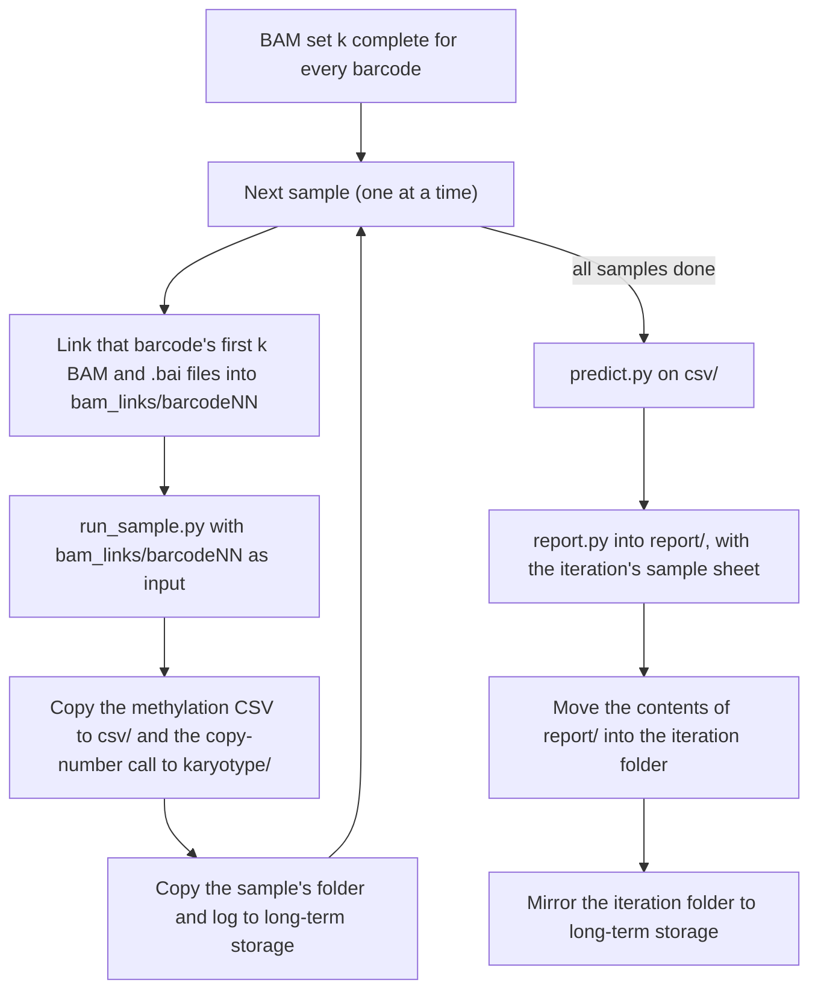

# SPARSH Run Manager

A Linux desktop application that follows an Oxford Nanopore sequencing run while it is in progress, or replays a finished one, and runs the SPARSH DNA-methylation classifier for acute leukemia on each new set of BAM files of the samples and barcodes you list. For every set it runs SPARSH's `run_sample.py` once per sample, then `predict.py` and `report.py` once for all samples together, writes the results to a local folder and copies them to long-term storage.

The application is a launcher. It does not contain SPARSH, which is installed separately with its own conda environment; see [Requirements](#requirements).


## Contents

- [What it does](#what-it-does)
- [Requirements](#requirements)
- [Installation](#installation)
- [Everything from scratch, step by step](#everything-from-scratch-step-by-step)
- [First-time setup](#first-time-setup)
- [Running an analysis](#running-an-analysis)
- [The window](#the-window)
- [How it works](#how-it-works)
- [Output folders](#output-folders)
- [Logs and troubleshooting](#logs-and-troubleshooting)
- [Limitations](#limitations)
- [Building the Linux package](#building-the-linux-package)
- [Project layout](#project-layout)

## What it does

MinKNOW writes each barcode's reads into numbered BAM files inside the run's `bam_pass` folder. The Run Manager watches only the barcode folders of the samples you add, and treats the k-th BAM file of every barcode as BAM set k. As soon as every barcode has a complete k-th file, it starts iteration k, which analyses the first k files of every barcode, so each iteration has all the data up to that point and a finished run is replayed set by set.

In an iteration, `run_sample.py` runs for one sample at a time, on a folder of links to exactly the BAM files of that iteration, so the workstation is not overloaded and files that MinKNOW writes during the analysis cannot slip in. When the last sample has finished, each sample's methylation file and copy-number call are collected and `predict.py` and `report.py` run once for the whole set. The iteration folder is then mirrored to long-term storage with the same structure; BAM files are never copied.

The window shows each sample's status, its BAM files and the data rate, the command being executed and the log as it is written. Stop Analysis pauses the iteration and kills the running job; Start Analysis resumes it.

## Requirements

To run the packaged application you need Linux x86_64 with glibc 2.35 or newer, which is Ubuntu 22.04 or later, a desktop session (the application is a window, not a command-line tool) and `bash`. On older systems, [run from source](#run-from-source).

For the analysis you need the following.

A SPARSH installation, that is, a clone of the SPARSH repository (https://github.com/patkarlab/sparsh) with its conda environment made from `envs/sparsh.yml` as the SPARSH README describes. That environment provides Python with PyTorch, samtools, modkit and minimap2, which the SPARSH scripts need. dorado, SPARSH's default aligner, is not packaged for conda; install it from Oxford Nanopore's releases when you want reads aligned with it, or choose minimap2 as the aligner in Settings. No aligner is used when MinKNOW has already aligned the reads to the same reference (see [When the reads need aligning](#when-the-reads-need-aligning)).

The three files SPARSH works with: the GRCh37 reference genome as one FASTA file with its samtools index (`.fai`) next to it, made as the SPARSH README describes (for example `hg19_main.fa`); Illumina's MethylationEPIC v2.0 manifest, `EPIC-8v2-0_A2.csv`; and the model folder from Zenodo, for example `sparsh_model_0.4.0`. Their locations are set once in Settings. When the reference and the manifest are in `<SPARSH folder>/references/` and the model folder is inside the SPARSH folder, the boxes can stay blank and the files are found by name.

MinKNOW output with barcoded BAM files, `<run folder>/…/bam_pass/barcodeNN/*.bam`, ideally with a `.bai` index next to each BAM file. The reads must carry the modified-base calls for 5-methylcytosine and 5-hydroxymethylcytosine at CpGs (the MM and ML tags written when basecalling with a modified-base model), as SPARSH requires.

A local output folder on a drive that supports symbolic links, which any Linux-formatted drive does ([why](#what-happens-in-an-iteration)).

## Installation

### From the release tarball

Download `SPARSH-RunManager-<version>-linux-x86_64.tar.gz` from the Releases page, then:

```bash
tar -xf SPARSH-RunManager-*-linux-x86_64.tar.gz
cd sparsh-run-manager
bash install.sh
```

`install.sh` installs for the current user only, without `sudo`: the application goes to `~/.local/share/sparsh-run-manager/`, a `sparsh-run-manager` command to `~/.local/bin/`, and a launcher to the application menu and to the desktop. Start it from the menu, by double-clicking the desktop icon, or by running `sparsh-run-manager` in a terminal. Started from a terminal, it also prints each iteration's links folder there.

If the desktop shows the launcher as untrusted, right-click it and choose Allow Launching. If the `sparsh-run-manager` command is not found, log out and back in so that `~/.local/bin` is on your PATH.

Settings are kept in `~/.config/sparsh-run-manager/sparsh_config.json`, so updating the application (install the new tarball the same way) and uninstalling it leave them in place. To uninstall, run `bash ~/.local/share/sparsh-run-manager/uninstall.sh`; add `--settings` to remove the settings as well.

### Run from source

Needs Python 3.10 or later with Tk. On Ubuntu or Debian:

```bash
sudo apt install python3-tk python3-venv
git clone https://github.com/patkarlab/sparsh-gui-repo
cd sparsh-gui-repo
python3 -m venv .venv
. .venv/bin/activate
pip install -r requirements.txt
python main.py
```

Later, `. .venv/bin/activate && python main.py` from the same folder starts it again (`python -m sparsh` also works). The only Python dependency is CustomTkinter.

## Everything from scratch, step by step

The commands below set up a workstation that has nothing yet: SPARSH with its conda environment, the three files it needs, placed so that the Run Manager finds them by name, and the Run Manager itself. They follow the SPARSH README (https://github.com/patkarlab/sparsh), which has the details and the test suite. Conda (Miniconda or Anaconda) is assumed to be installed; `conda` can be replaced by `mamba` or `micromamba` throughout.

SPARSH and its environment. The clone goes to `~/sparsh`, which becomes the SPARSH folder in Settings:

```bash
git clone https://github.com/patkarlab/sparsh.git ~/sparsh
cd ~/sparsh
conda env create -f envs/sparsh.yml
conda activate sparsh
python -c "import torch; print(torch.__version__, torch.cuda.is_available())"
samtools --version | head -1
modkit --version
```

The reference genome, made exactly as in the SPARSH README and placed in `~/sparsh/references/`, where it is found as `hg19_main.fa`. The index for minimap2 is only needed when minimap2 is the aligner, but it saves building it for every sample:

```bash
mkdir -p ~/sparsh/references
cd ~/sparsh/references
wget https://hgdownload.soe.ucsc.edu/goldenPath/hg19/bigZips/hg19.fa.gz
gunzip hg19.fa.gz
samtools faidx hg19.fa
samtools faidx -n 50 hg19.fa chr{1..22} chrX chrY > hg19_main.fa
md5sum hg19_main.fa                                            # 1831aa6238818b0686686125b51b91e5
samtools faidx hg19_main.fa
minimap2 -x map-ont -d hg19_main.fa.map-ont.mmi hg19_main.fa
rm hg19.fa hg19.fa.fai
```

The manifest. Download Illumina's Infinium MethylationEPIC v2.0 manifest, `EPIC-8v2-0_A2.csv`, from the Infinium MethylationEPIC v2.0 Product Files page (https://support.illumina.com/downloads/infinium-methylationepic-v2-0-product-files.html), unzip it if it came as a zip file, and move it next to the reference:

```bash
mv ~/Downloads/EPIC-8v2-0_A2.csv ~/sparsh/references/
```

The model. Download the seven parts of `sparsh_model_0.4.0.zip` from the Zenodo record (10.5281/zenodo.23118416; see the SPARSH README for access) into one folder, then join, unpack and check them inside `~/sparsh`, where the model folder is found by name:

```bash
cd ~/sparsh
cat ~/Downloads/sparsh_model_0.4.0.zip.part* > sparsh_model_0.4.0.zip
unzip sparsh_model_0.4.0.zip
(cd sparsh_model_0.4.0 && sha256sum -c SHA256SUMS)             # every line should end in OK
rm sparsh_model_0.4.0.zip
```

The aligner, only for runs whose reads are not already aligned to this reference. Either choose minimap2 as the aligner in Settings (it is in the environment), or install dorado from Oxford Nanopore's releases (https://github.com/nanoporetech/dorado) and give its path in the extra options of Settings. On a MinKNOW machine dorado is usually already present:

```bash
ls /opt/ont/dorado/bin/dorado           # if it exists: --dorado /opt/ont/dorado/bin/dorado in the extra options
```

A check of the SPARSH installation, optional, about seven minutes on two cores:

```bash
cd ~/sparsh
bash tests/run_all.sh
```

The Run Manager, from the release tarball:

```bash
cd ~/Downloads
tar -xf SPARSH-RunManager-*-linux-x86_64.tar.gz
cd sparsh-run-manager
bash install.sh
sparsh-run-manager
```

or from source:

```bash
sudo apt install python3-tk python3-venv
git clone https://github.com/patkarlab/sparsh-gui-repo ~/sparsh-gui-repo
cd ~/sparsh-gui-repo
python3 -m venv .venv
. .venv/bin/activate
pip install -r requirements.txt
python main.py
```

In the window, on the Settings tab, set the SPARSH folder to `~/sparsh` (or press Browse), check that `conda.sh` points to your conda installation, press Check setup, which should list `run_sample.py`, `hg19_main.fa`, `EPIC-8v2-0_A2.csv`, `sparsh_model_0.4.0` and the environment, and press Save settings. [First-time setup](#first-time-setup) describes the remaining options.

## First-time setup

On the first start the window opens on the Settings tab, because the SPARSH folder has to be known before anything can run.

1. SPARSH folder: the SPARSH repository folder, the one that contains `scripts/run_sample.py`, `scripts/predict.py` and `scripts/report.py`.
2. Reference FASTA, EPIC manifest and Model folder: leave blank when they are inside the SPARSH folder under their usual names (the reference and manifest in `references/`, the model folder at the top level), otherwise give their locations.
3. Environment name and `conda.sh`: the conda environment SPARSH runs in (`sparsh` when made from `envs/sparsh.yml`) and the `conda.sh` of your conda installation, which is `<conda folder>/etc/profile.d/conda.sh`. The box is filled in when one of the usual installations (Anaconda, Miniconda, Miniforge, Mambaforge, in your home folder or in `/opt`) is found.
4. Analysis options: a copy-number panel file if your laboratory has made one (blank passes `--no_panel`); a default blast percentage for samples that are added without one; the aligner for reads that need aligning (dorado or minimap2); the number of threads; the device for the predictions (`cuda` uses the graphics card and falls back to the processor when there is none); and any extra options for `run_sample.py`, typed as in a terminal, for example `--dorado /opt/ont/dorado/bin/dorado` when dorado is installed but not on the PATH.
5. Press Check setup to see which files were found, then Save settings.

The scan interval and the BAM stable wait under Watching the run, and the appearance of the window, rarely need changing; they are explained on the tab.

## Running an analysis

On the Run tab, for each sequencing run:

1. Run folder: the MinKNOW run folder. The `bam_pass` folder inside it is found automatically, up to five folder levels down; if MinKNOW has not created it yet, the application keeps looking.
2. Local output: a fast local disk, where the results are written during the run. Long-term storage (optional): each iteration is copied there, without BAM files.
3. Output folder name: the folder created inside both outputs to hold the iterations. It defaults to today's date (`dd_mm_yyyy`); letters, numbers, `.`, `_` and `-` only. The line next to it shows where the results will go, and Open opens that folder.
4. Add each sample with its barcode number, or press Import list… to load a CSV or TSV file with the columns `sample`, `barcode` and optionally `sex`, `blast_percent` and `max_runs`. Export list… saves the current list in that format, and the list is also written to `<Local output>/<Output folder name>/run_manager_samples.csv` when the analysis starts, so it can be imported again after the application has been closed.
5. Press Start Analysis.

From then on, each BAM set is analysed as soon as every barcode has it, until you press Stop Analysis or close the window. The run folder and the two output folders are remembered from the last Start; the output folder name starts at that day's date each time the application opens.

### Sample fields

Sample: the sample name as it will appear in the results. Letters, numbers, `.`, `_` and `-`, starting with a letter or number, as `run_sample.py` requires. SPARSH compares names without regard to case, so two names that differ only in case count as the same sample.

Barcode: 01 to 99. `1`, `01`, `barcode01`, `BC01` and `NB01` all mean `barcode01`. Each barcode can belong to only one sample.

Sex (optional): F or M, passed as `--sex`. The copy-number call uses it to read chromosomes X and Y.

Blast % (optional): the leukemic blast percentage of the sample, above 0 and at most 100, decimals allowed, passed as `--blast_percent`. The copy-number call keeps the leukemic fraction within 20 points of it. Blank uses the default from Settings, and when that is blank too the option is left out.

Max runs (optional): stop analysing this sample after this many successful iterations. 0 means no limit.

Remove a sample with its ✕ button; this is not possible while that sample is being analysed. Samples cannot be edited once added: remove the sample and add it again.

## The window

### Sample table

Done counts the sample's successful iterations, shown as for example `2/5` when Max runs is set. GB/hr is the BAM data written per hour, measured over the last hour; it appears after ten minutes of watching. Status is Waiting (no BAM files yet), Sequencing (has BAM files and is waiting for the next set), Queued (part of the current iteration, waiting for its turn), Analysing (`run_sample.py` is running for it), Done (reached its Max runs) or Error (its last `run_sample.py` failed; it is tried again in the next iteration). Click a sample to show its files, folders and log in the right-hand panels.

### Start and Stop

Start Analysis first checks the setup and lists anything missing: the run folder, an output folder, samples, the output folder name, the SPARSH files, the reference index or `conda.sh`. It warns when no conda environment of the given name is found in the usual places, and asks before creating a long-term storage folder that does not exist, since a missing folder usually means a drive that is not mounted. It creates the output folders if they do not exist.

Stop Analysis pauses: it kills the running job, including its child processes, and keeps the current iteration. Pressing Start Analysis again resumes that iteration in the same folder, as long as the run folder, the local output and the output folder name have not changed. If you close the window while a job is running, the application asks first and then stops the job.

### Right-hand panels

Currently analysing shows the iteration and step in progress, how long the step has run, and each sample's state, or what the next BAM set is waiting for (for example `2 of 3 files ready`).

Completed lists each finished iteration with its time, its result (`report ready`, `predict.py failed` and so on), each sample marked ✓ or ✗, its folder, and an Open button.

BAM files lists the selected sample's BAM files in set order, each marked growing, settling, writing, no .bai yet, ready or analysed.

The four cards show the selected sample's GB per hour, number of BAM files, data written and analyses done, and the lines below them show where its output, its long-term storage copy and its BAM links folder are for its current or latest iteration.

Command being executed shows the exact script running now, or the last one that ran. Log shows the selected sample's messages and SPARSH's own output as it runs.

The status bar shows whether the application is watching, the `bam_pass` folder it found, sample counts, and the time of the last scan.

### Settings

The Settings tab holds everything described under [First-time setup](#first-time-setup). Changes saved during a run apply from the next command; the scan interval and the BAM stable wait apply after Stop and Start. Reset to defaults only changes the boxes; nothing is saved until Save settings is pressed.

## How it works

### BAM sets and iterations

MinKNOW writes each barcode's reads into numbered BAM files (`…_0.bam`, `…_1.bam`, …), usually each with a `.bai` index. BAM set k is the k-th file of every barcode, and iteration k analyses sets 1 to k, which is all the data up to that point. A finished run is therefore replayed set by set, giving one iteration per BAM file.

Only the barcode folders of the samples you added are read. Other barcodes and `unclassified` are ignored.

### When a BAM file counts as complete

A BAM file is complete when it is no longer growing and one of these is true: its `.bai` index exists; the run has finished and the file has settled; or none of your barcode folders has `.bai` files, the file has settled, and a newer BAM file exists in the same folder (MinKNOW has moved on to the next file).

Settled means its size has not changed, or it has not been modified, for the BAM stable wait (60 seconds by default). The run counts as finished once MinKNOW has written `final_summary*.txt` next to `bam_pass`.

### When an iteration starts

During a live run, iteration k starts once every sample's barcode has a complete k-th file, however long that takes, because `predict.py` and `report.py` need outputs from every barcode. A barcode that never produces files, such as an empty barcode or a mistyped number, holds up the run; remove that sample with ✕ to continue.

Once the run has finished, no more files will come, so the remaining sets run with every sample. A barcode that has run out of files is analysed again with all of its files, so the iteration still has outputs from every barcode, and a barcode with no BAM files at all is left out, with a note in its log.

### When the reads need aligning

`run_sample.py` uses the BAM files as they are when every one of them is aligned to the reference FASTA given in Settings, with the same sequence names and lengths; it then only merges, sorts and indexes them. Otherwise it aligns the reads again, with dorado or minimap2 according to the Aligner setting, which takes considerably longer. If MinKNOW is set to align the reads to that same reference during the run, each iteration therefore starts with the merge and no aligner is needed on the workstation.

### What happens in an iteration



1. Links folder. For each sample, `bam_links/barcodeNN/` gets symbolic links to that barcode's first k BAM files and their `.bai` files. This folder, not the live `bam_pass` folder, is passed to `run_sample.py` as `--bam`, so files MinKNOW writes during the analysis cannot slip in. If the drive cannot hold symbolic links, hard links are tried; these only work on the same disk as `bam_pass`, and if neither works the sample fails with a clear message. The folder's location is printed in the Log panel, at the top of `<sample>.log`, in the panels, and in the terminal if the application was started from one.
2. `run_sample.py` runs for one sample at a time.
3. Collecting. The sample's `methylation/*.csv` file is copied into the iteration's `csv/` folder, and the files of its copy-number call in `copy_number/calls/` that are named after the sample (the karyotype JSON, the segments and the figures; SPARSH writes the name in capitals) into `karyotype/`.
4. The sample's folder and log are copied to long-term storage, without BAM files.
5. `predict.py` runs once on `csv/` after the last sample. Then `sample_sheet.csv` is written with the sample, sex and blast percentage of every sample that has a prediction, and `report.py` writes into `report/` with that sheet, so the combined report shows them. Everything `report.py` produced is moved up into the iteration folder, and the empty `report/` is removed. The move never overwrites the application's own items (sample folders and logs, `csv/`, `karyotype/`, `predictions/`, `bam_links/`, `sample_sheet.csv`); anything with one of those names stays in `report/`, and the log says so.
6. The whole iteration folder is mirrored to long-term storage.

If a sample's `run_sample.py` fails, the other samples carry on, `predict.py` and `report.py` run with the samples that succeeded, and the failed sample is tried again in the next iteration. If no sample succeeds, `predict.py` and `report.py` are skipped.

### Commands

Each command runs as a `bash` script from inside the SPARSH folder, after activating the conda environment. Its output is saved to a log and shown live in the window:

```bash
set -e
source ~/miniconda3/etc/profile.d/conda.sh
conda activate sparsh
cd <SPARSH folder>
set -o pipefail
python … 2>&1 | tee -a <log file>
```

Library paths set by the packaged application are restored to yours for these commands, so the conda environment uses its own libraries.

`run_sample.py` runs once per sample, where `<iter>` is `<Local output>/<Output folder name>/<k>`:

```bash
python <SPARSH folder>/scripts/run_sample.py \
    --sample AML-0143 \
    --bam <iter>/bam_links/barcode02 \
    --out_dir <iter>/AML-0143 \
    --reference <reference FASTA> \
    --manifest <EPIC manifest> \
    --model_dir <model folder> \
    --no_panel \
    --sex F \
    --blast_percent 80 \
    --threads 8 \
    --aligner dorado \
    --device cuda
```

`--no_panel` becomes `--panel <file>` when a copy-number panel file is set. `--sex` and `--blast_percent` appear only when they are given. The extra options from Settings are appended at the end, so an option given there overrides the one before it.

`predict.py` and `report.py` run once per iteration:

```bash
python <SPARSH folder>/scripts/predict.py \
    --model_dir <model folder> \
    --ont_dir <iter>/csv \
    --output_dir <iter>/predictions \
    --device cuda

python <SPARSH folder>/scripts/report.py \
    --predictions_dir <iter>/predictions \
    --karyotype_dir <iter>/karyotype \
    --output_dir <iter>/report \
    --title "SPARSH report: <Output folder name>, iteration <k>" \
    --sample_sheet <iter>/sample_sheet.csv
```

## Output folders

```
<Local output>/<Output folder name>/       e.g. /home/lab/sparsh_results/03_11_2026/
├── sparsh_run_info.txt       which run this folder belongs to
├── run_manager_samples.csv   the sample list, for Import list…
├── 1/                        iteration 1: BAM set 1
│   ├── bam_links/
│   │   ├── barcode01/        links to barcode01's first BAM file (and .bai)
│   │   └── barcode02/
│   ├── AML-0142/             run_sample.py output
│   ├── AML-0142.log
│   ├── AML-0143/
│   ├── AML-0143.log
│   ├── csv/                  every sample's methylation CSV file
│   ├── karyotype/            every sample's copy-number call
│   ├── sample_sheet.csv      sample, sex and blast percentage, for the report
│   ├── predictions/          predict.py output
│   ├── …                     report.py output, moved up from report/
│   └── predict_report.log
├── 2/                        iteration 2: BAM sets 1–2
└── …
```

Long-term storage gets the same structure under `<Long-term storage>/<Output folder name>/`. Each sample's folder and log are copied as soon as that sample finishes, and the whole iteration is mirrored at the end. BAM and index files (`.bam`, `.bai`, `.cram`, `.crai`, `.csi`) and the links are never copied, so the `bam_links/` folders are empty there. Files that are already up to date are skipped, and nothing in long-term storage is ever deleted.

Iteration numbers continue from the iteration folders already present, locally or in long-term storage, so a run can be picked up again after the application has been closed. Because the default folder name is the date, two runs on the same day would otherwise share a folder. To prevent that, `sparsh_run_info.txt` records which run folder an output folder belongs to; Start refuses an output folder that holds another run's results and asks for a different name; and if the folder already has iterations from this run, Start asks before continuing from the next one (it does not ask again after Stop and Start in the same session). To redo a run from BAM set 1, use a new output folder name.

## Logs and troubleshooting

The Log panel shows the selected sample's messages and SPARSH output (the latest lines). `<iter>/<sample>.log` holds the links folder used and the full `run_sample.py` output, and `run_sample.py` itself writes `run.log` and `run_info.json` inside `<iter>/<sample>/`. `<iter>/predict_report.log` holds the `predict.py` and `report.py` output. If the application was started from a terminal, `[SPARSH] …` lines there give each iteration's links folder.

Can't start yet: the message lists what is missing. The SPARSH files are looked for as described under [First-time setup](#first-time-setup); Check setup on the Settings tab shows what was found.

The status bar says Looking for bam_pass…: the run folder is wrong, or MinKNOW has not created `bam_pass` yet. The application keeps looking.

An iteration never starts: Currently analysing shows which barcode is short (for example `0 of 1 files ready`). Check its barcode number, or remove that sample.

Files stay at no .bai yet: your barcodes have `.bai` files, so each BAM file waits for its own index. Once the run finishes, files without one are used too.

A sample shows Error: read `<iter>/<sample>.log`, or select the sample and read the Log panel. The common causes are a conda environment that lacks samtools or modkit, reads that need aligning on a workstation without dorado (choose minimap2 as the aligner, or give dorado's path in the extra options), and a reference FASTA without its `.fai` index.

predict.py failed or report.py failed: read `<iter>/predict_report.log`.

Could not prepare the BAM links folder: the local output drive cannot hold links. Choose a local output folder on a Linux-formatted drive.

Output folder name already used: that folder holds another run. Enter a different name.

The application will not start and mentions `GLIBC_2.35` or a similar version: the system is older than Ubuntu 22.04. [Run from source](#run-from-source) instead.

## Limitations

Linux only. Commands run through `bash` and `conda.sh`, and stopping relies on Unix process groups.

Samples and progress are not kept when the application closes. Import the sample list written to the output folder (or add the samples again) after reopening; iteration numbering continues after you confirm.

One `bam_pass` folder per run folder: the first one found is used.

Barcodes 01 to 99 only.

GB per hour is calculated from the sizes of the BAM files.

## Building the Linux package

`packaging/build.sh` makes `dist/sparsh-run-manager/`, a self-contained folder with the Python runtime, Tk and CustomTkinter, and the release tarball `dist/SPARSH-RunManager-<version>-linux-x86_64.tar.gz` with `install.sh`, `uninstall.sh` and the icon inside. Build on the oldest Linux the package has to run on, because the result needs that system's glibc version or newer:

```bash
sudo apt install python3-tk python3-venv binutils
bash packaging/build.sh
```

Set `PYTHON` to build with another interpreter, for example `PYTHON=python3.12 bash packaging/build.sh`. The version comes from `sparsh/__init__.py`.

The GitHub Actions workflow in `.github/workflows/build.yml` runs the same script in an Ubuntu 22.04 container, checks that the package starts on a virtual display, and attaches the tarball to a GitHub Release when a tag such as `v1.1.0` is pushed (the tag must match `__version__`). It can also be started by hand from the Actions page.

## Project layout

```
main.py                   starts the application (python main.py)
sparsh/
├── __init__.py           version and name
├── __main__.py           python -m sparsh
├── gui.py                window and panels (CustomTkinter)
├── watcher.py            scans the samples' barcode folders
├── runner.py             iterations, links, SPARSH commands, long-term storage copies
├── state.py              shared state for the window, watcher and runner
├── paths.py              finds the SPARSH files from the settings
└── config.py             settings, saved to ~/.config/sparsh-run-manager/
packaging/
├── build.sh              builds the Linux package
├── install.sh            installer included in the release tarball
└── uninstall.sh          remover included in the release tarball
assets/icon.png           application icon
docs/screenshot.png       the screenshot in this README
requirements.txt          the Python dependency (CustomTkinter)
```
