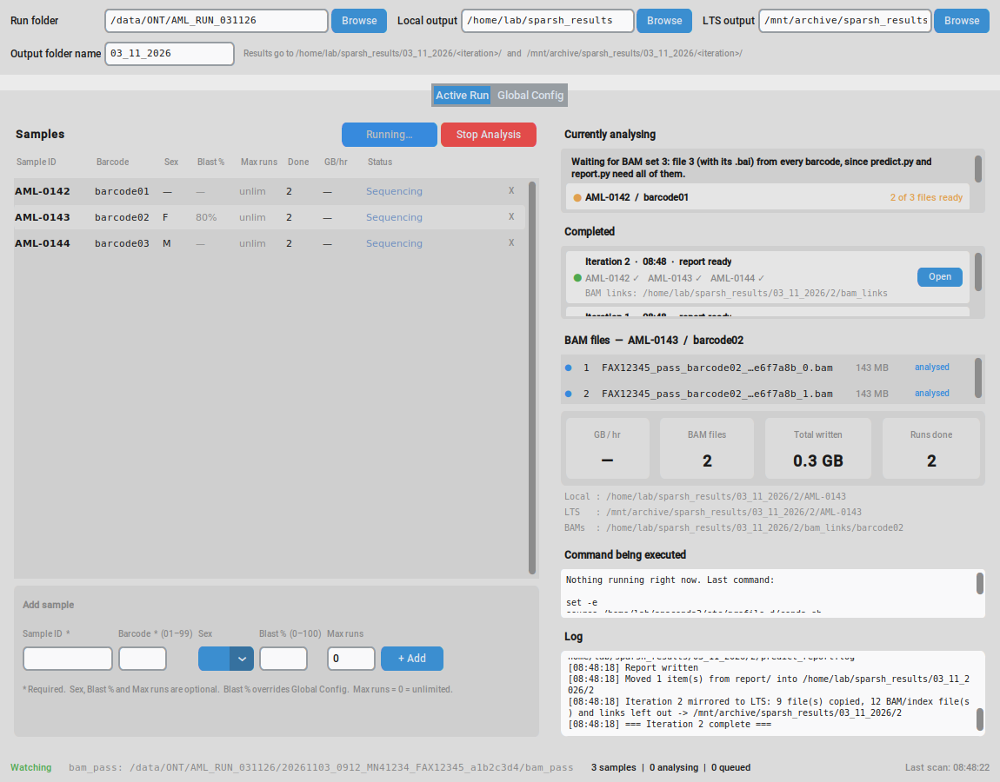
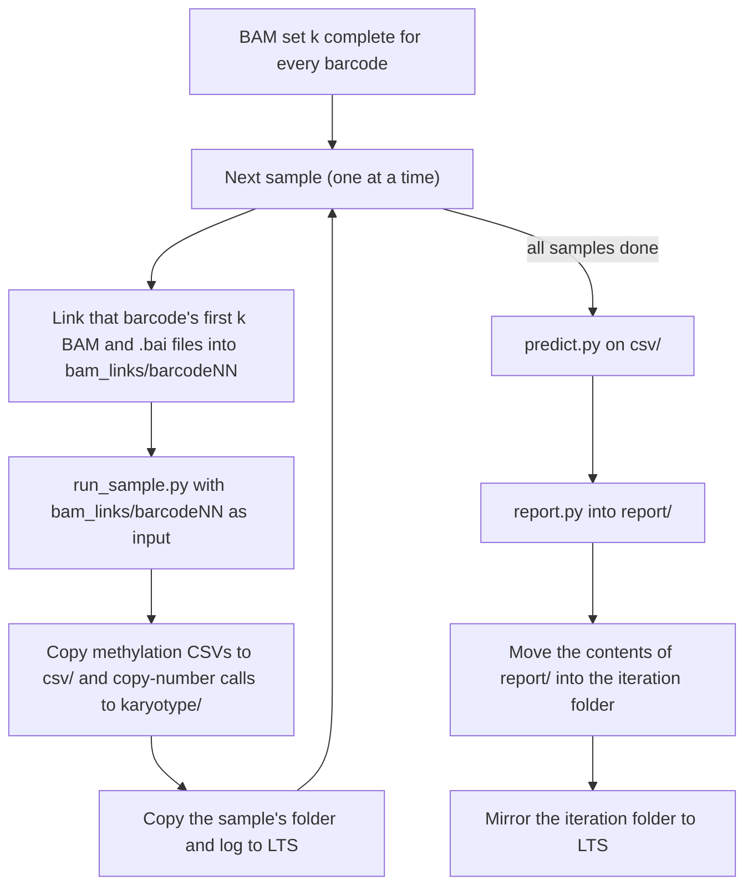

# SPARSH Run Manager

A Linux desktop app that follows an Oxford Nanopore run while it sequences, or replays a finished one, and runs the SPARSH DNA-methylation pipeline for acute leukemia on each new set of BAM files for the samples and barcodes you list. For every set it runs `run_sample.py` once per sample, then `predict.py` and `report.py` once for all samples together, writes the results to a local folder and copies them to long-term storage.

The app is a launcher: it does not include SPARSH, which must be installed separately with its own conda environment.



## Contents

- [Features](#features)
- [Requirements](#requirements)
- [Installation](#installation)
- [Quick start](#quick-start)
- [The window](#the-window)
- [How it works](#how-it-works)
- [Output folders](#output-folders)
- [Logs and troubleshooting](#logs-and-troubleshooting)
- [Limitations](#limitations)
- [Building the Linux package](#building-the-linux-package)
- [Project layout](#project-layout)

## Features

- **Watches only your barcodes.** It reads only the barcode folders of the samples you add, inside the run's `bam_pass` folder, which it finds automatically.
- **One iteration per BAM set.** Iteration *k* analyses the first *k* BAM files of every barcode, so a finished run is replayed set by set.
- **Waits for every barcode** before starting an iteration, because `predict.py` and `report.py` need outputs from all of them.
- **Exact inputs.** `run_sample.py` gets a folder of links to exactly the BAM files for that iteration.
- **One sample at a time**, so the workstation is not overloaded.
- **Once per iteration**, each sample's methylation CSVs and copy-number calls are collected and `predict.py` and `report.py` run.
- **Long-term storage copy** with the same folder structure; BAM files are never copied.
- **Stop pauses** the iteration and kills the running job; Start resumes it.
- **Live progress:** per-sample status, BAM files, throughput, the command being executed, and the log.

## Requirements

**To run the packaged app**

- Linux x86_64 with glibc 2.38 or newer, which means Ubuntu 24.04 or later. On older systems, [run from source](#run-from-source).
- A desktop session (the app is a window, not a command-line tool) and `bash`.

**For the analysis**

- A SPARSH folder laid out like this (the names are fixed):

  ```
  <SPARSH folder>/
  ├── scripts/
  │   ├── run_sample.py
  │   ├── predict.py
  │   └── report.py
  ├── references/
  │   ├── hg19_all.fasta
  │   └── EPIC-8v2-0_A2.csv
  └── sparsh_model_0.4.0/
  ```

- Anaconda or Miniconda, with a conda environment in which SPARSH runs (default name `sparsh`).
- MinKNOW output with barcoded BAM files, `<run folder>/…/bam_pass/barcodeNN/*.bam`, ideally with a `.bai` index next to each BAM.
- A local output folder on a drive that supports symbolic links, which any Linux-formatted drive does ([why](#what-happens-in-an-iteration)).

## Installation

### From the release tarball

Download `SPARSH-RunManager-1.0.0-linux-x86_64.tar.gz` from the Releases page, then:

```bash
tar -xf SPARSH-RunManager-1.0.0-linux-x86_64.tar.gz
cd sparsh-run-manager
bash install.sh
```

`install.sh` installs for the current user only, without `sudo`:

| What | Where |
|---|---|
| The app | `~/.local/share/sparsh-run-manager/` |
| A command to start it | `~/.local/bin/sparsh-run-manager` |
| A desktop launcher | `~/Desktop/sparsh-run-manager.desktop` |

Start it by double-clicking **SPARSH Run Manager** on the desktop, or by running `sparsh-run-manager` in a terminal. Started from a terminal, it also prints each iteration's links folder there.

If the desktop shows the launcher as untrusted, right-click it and choose **Allow Launching**. If the `sparsh-run-manager` command isn't found, log out and back in so that `~/.local/bin` is on your `PATH`.

To update, install the new tarball the same way. Your settings are kept.

### Uninstall

```bash
rm -rf ~/.local/share/sparsh-run-manager
rm -f ~/.local/bin/sparsh-run-manager ~/Desktop/sparsh-run-manager.desktop
```

### Run from source

Needs Python 3.10 or later with Tk:

```bash
sudo apt install python3-tk python3-venv
python3 -m venv .venv
. .venv/bin/activate
pip install customtkinter
python main.py
```

## Quick start

**Once**, on the **Global Config** tab:

1. **SPARSH folder**: the folder described under [Requirements](#requirements).
2. **Conda env name**: the environment SPARSH runs in (`sparsh` by default).
3. **conda.sh path**: usually `~/anaconda3/etc/profile.d/conda.sh`, or `~/miniconda3/etc/profile.d/conda.sh` for Miniconda.
4. Press **Save config**.

**For each run**, on the **Active Run** tab:

1. **Run folder**: the MinKNOW run folder. The `bam_pass` folder inside it is found automatically.
2. **Local output**: where results are written during the run. **LTS output** (optional): long-term storage.
3. **Output folder name**: today's date by default (`dd_mm_yyyy`).
4. Add each sample with its barcode number.
5. Press **Start Analysis**.

From then on, each BAM set is analysed as soon as every barcode has it, until you press **Stop Analysis** or close the window.

## The window

### Top bar

| Field | What it is |
|---|---|
| Run folder | The MinKNOW run folder. `bam_pass` is looked for up to five folder levels below it; if MinKNOW hasn't created it yet, the app keeps looking. |
| Local output | Fast local disk. Results are written here during the run. |
| LTS output | Optional long-term storage. Each iteration is copied here, without BAM files. |
| Output folder name | The folder created inside both outputs to hold the iterations. Defaults to today's date (`dd_mm_yyyy`). Letters, numbers, `.`, `_` and `-` only. The line next to it shows where results will go. |

The run folder and the two output folders are remembered from the last time you pressed Start. The output folder name starts at that day's date each time the app opens.

### Adding samples

| Field | Required | Notes |
|---|---|---|
| Sample ID | Yes | Letters, numbers, `.`, `_` and `-`. |
| Barcode | Yes | 01–99. `1`, `01` and `barcode01` all mean `barcode01`. Each barcode can belong to only one sample. |
| Sex | No | `F` or `M`, passed as `--sex`. Left out if blank. |
| Blast % | No | Whole number from 0 to 100, passed as `--blast_percent`. Overrides the Global Config value for this sample. |
| Max runs | No | Stop analysing this sample after this many successful iterations. `0` means no limit. |

Remove a sample with its **X** button. This isn't possible while that sample is being analysed.

### Sample table

**Done** counts successful iterations (shown as, for example, `2/5` when Max runs is set). **GB/hr** is the BAM data written per hour, measured over the last hour; it appears after 10 minutes of watching. **Status** is one of:

| Status | Meaning |
|---|---|
| Waiting | No BAM files yet. |
| Sequencing | Has BAM files and is waiting for the next BAM set. |
| Queued | Part of the current iteration, waiting for its turn. |
| Analysing | `run_sample.py` is running for this sample. |
| Done | Reached its Max runs. |
| Error | Its last `run_sample.py` failed. It is tried again in the next iteration. |

### Start and Stop

**Start Analysis** first checks the setup and lists anything missing: the run folder, an output folder, samples, the output folder name, SPARSH files, `conda.sh` or the panel file. It creates the output folders if they don't exist.

**Stop Analysis** pauses: it kills the running job, including its child processes, and keeps the current iteration. Pressing **Start Analysis** again resumes that iteration in the same folder, as long as the run folder, local output and output folder name haven't changed. If you close the window while a job is running, the app asks first and then stops the job.

### Right-hand panels

| Panel | Shows |
|---|---|
| Currently analysing | The iteration and step in progress with each sample's state, or what the next BAM set is waiting for (for example `2 of 3 files ready`). |
| Completed | Each finished iteration: its time, its result (`report ready`, `predict.py failed`, …), each sample marked ✓ or ✗, its BAM links folder, and an **Open** button for its folder. |
| BAM files | The selected sample's BAM files in set order, each marked growing, settling, writing, no .bai yet, ready or analysed. |
| Metrics | GB/hr, number of BAM files, total written and iterations done. |
| Local / LTS / BAMs | Where the selected sample's output, LTS copy and links folder are for its current or latest iteration. |
| Command being executed | The exact script running now, or the last one that ran. |
| Log | The selected sample's log, including SPARSH's own output as it runs. |

The status bar shows whether the app is watching, the `bam_pass` folder it found, sample counts, and the time of the last scan.

### Global Config

| Setting | Default | Notes |
|---|---|---|
| SPARSH folder | — | Must contain the files listed under [Requirements](#requirements). |
| Conda env name | `sparsh` | Activated before every command. |
| conda.sh path | `~/anaconda3/etc/profile.d/conda.sh` | Use `~/miniconda3/etc/profile.d/conda.sh` for Miniconda. |
| CN panel file | blank | Blank passes `--no_panel`; a file passes `--panel <file>`. |
| BLAST % identity | blank | Blank leaves out `--blast_percent`. A sample's own Blast % takes precedence. |
| Watch interval (s) | `30` | How often the barcode folders are scanned. |
| BAM stable wait (s) | `60` | How long a BAM file without a `.bai` must stay unchanged to count as finished ([details](#when-a-bam-file-counts-as-complete)). |

Settings are saved in `sparsh_config.json`: in `~/.local/share/sparsh-run-manager/_internal/` for the installed app, or next to `main.py` when running from source. Changes saved during a run apply from the next command; the two watcher timings apply after Stop and Start.

## How it works

### BAM sets and iterations

MinKNOW writes each barcode's reads into numbered BAM files (`…_0.bam`, `…_1.bam`, …), usually each with a `.bai` index. **BAM set *k*** is the *k*-th file of every barcode, and **iteration *k*** analyses sets 1 to *k*, which is all the data up to that point. A finished run is therefore replayed set by set, giving one iteration per BAM file.

Only the barcode folders of the samples you added are read. Other barcodes and `unclassified` are ignored.

### When a BAM file counts as complete

A BAM file is complete when it is no longer growing and one of these is true:

- its `.bai` index exists;
- the run has finished and the file has settled;
- none of your barcode folders has `.bai` files, the file has settled, and a newer BAM exists in the same folder (MinKNOW has moved on to the next file).

*Settled* means its size hasn't changed, or it hasn't been modified, for **BAM stable wait** seconds. The run counts as finished once MinKNOW has written `final_summary*.txt` next to `bam_pass`.

### When an iteration starts

- **During a live run**, iteration *k* starts once every sample's barcode has a complete *k*-th file, however long that takes, because `predict.py` and `report.py` need outputs from every barcode. A barcode that never produces files, such as an empty barcode or a mistyped number, holds up the run. Remove that sample with **X** to continue.
- **Once the run has finished**, no more files will come, so the remaining sets run with every sample:
  - A barcode that has run out of files is analysed again with all of its files, so the iteration still has outputs from every barcode.
  - A barcode with no BAM files at all is left out, with a note in its log.

### What happens in an iteration



1. **Links folder.** For each sample, `bam_links/barcodeNN/` gets symbolic links to that barcode's first *k* BAM files and their `.bai` files.
   - This folder, not the live `bam_pass` folder, is passed to `run_sample.py` as `--bam`, so files MinKNOW writes during the analysis can't slip in.
   - If the drive can't hold symbolic links, hard links are tried. These only work on the same disk as `bam_pass`; if neither works, the sample fails with a clear message.
   - The folder's location is printed in the Log panel, at the top of `<sample>.log`, in the panels, and in the terminal if the app was started from one.
2. **`run_sample.py`** runs for one sample at a time.
3. **Collecting.** The sample's `methylation/*.csv` files are copied into the iteration's `csv/` folder, and its `copy_number/calls/*` into `karyotype/`.
4. **LTS copy** of that sample's folder and log, without BAM files.
5. **`predict.py`** runs once on `csv/` after the last sample, then **`report.py`** writes into `report/`.
   - Everything `report.py` produced is moved up into the iteration folder, and the empty `report/` is removed.
   - The move never overwrites the app's own items (sample folders and logs, `csv/`, `karyotype/`, `predictions/`, `bam_links/`). Anything with one of those names stays in `report/`, and the log says so.
6. The whole iteration folder is **mirrored to LTS**.

If a sample's `run_sample.py` fails, the other samples carry on, `predict.py` and `report.py` run with the samples that succeeded, and the failed sample is tried again in the next iteration. If no sample succeeds, `predict.py` and `report.py` are skipped.

### Commands

Each command runs as a `bash` script from inside the SPARSH folder, after activating the conda environment. Its output is saved to a log and shown live in the app:

```bash
set -e
source ~/anaconda3/etc/profile.d/conda.sh
conda activate sparsh
cd <SPARSH folder>
set -o pipefail
python … 2>&1 | tee -a <log file>
```

Library paths set by the packaged app are restored to yours for these commands, so the conda environment uses its own libraries.

`run_sample.py` runs once per sample, where `<iter>` is `<Local output>/<Output folder name>/<k>`:

```bash
python <SPARSH folder>/scripts/run_sample.py \
    --sample AML-0143 \
    --bam <iter>/bam_links/barcode02 \
    --out_dir <iter>/AML-0143 \
    --reference <SPARSH folder>/references/hg19_all.fasta \
    --manifest <SPARSH folder>/references/EPIC-8v2-0_A2.csv \
    --model_dir <SPARSH folder>/sparsh_model_0.4.0 \
    --no_panel \
    --sex F \
    --blast_percent 80
```

`--no_panel` becomes `--panel <file>` when a CN panel file is set. `--sex` and `--blast_percent` appear only when they are given.

`predict.py` and `report.py` run once per iteration:

```bash
python <SPARSH folder>/scripts/predict.py \
    --model_dir <SPARSH folder>/sparsh_model_0.4.0 \
    --ont_dir <iter>/csv \
    --output_dir <iter>/predictions

python <SPARSH folder>/scripts/report.py \
    --predictions_dir <iter>/predictions \
    --karyotype_dir <iter>/karyotype \
    --output_dir <iter>/report
```

## Output folders

```
<Local output>/<Output folder name>/       e.g. /home/lab/sparsh_results/03_11_2026/
├── sparsh_run_info.txt       which run this folder belongs to
├── 1/                        iteration 1: BAM set 1
│   ├── bam_links/
│   │   ├── barcode01/        links to barcode01's first BAM (and .bai)
│   │   └── barcode02/
│   ├── AML-0142/             run_sample.py output
│   ├── AML-0142.log
│   ├── AML-0143/
│   ├── AML-0143.log
│   ├── csv/                  every sample's methylation CSVs
│   ├── karyotype/            every sample's copy-number calls
│   ├── predictions/          predict.py output
│   ├── …                     report.py output, moved up from report/
│   └── predict_report.log
├── 2/                        iteration 2: BAM sets 1–2
└── …
```

**LTS** gets the same structure under `<LTS output>/<Output folder name>/`.

- Each sample's folder and log are copied as soon as that sample finishes, and the whole iteration is mirrored at the end.
- BAM and index files (`.bam`, `.bai`, `.cram`, `.crai`, `.csi`) and the links are never copied, so the `bam_links/` folders are empty there.
- Files that are already up to date are skipped, and nothing in LTS is ever deleted.

**Iteration numbers** continue from the iteration folders already present, locally or in LTS, so a run can be picked up again after the app has been closed. Because the default folder name is the date, two runs on the same day would otherwise share a folder. To prevent that:

- `sparsh_run_info.txt` records which run folder an output folder belongs to.
- Start refuses an output folder that holds another run's results and asks for a different name.
- If the folder already has iterations from this run, Start asks before continuing from the next one. It doesn't ask again after Stop and Start in the same session.

To redo a run from BAM set 1, use a new output folder name.

## Logs and troubleshooting

| Where | What |
|---|---|
| Log panel | The selected sample's messages and SPARSH output (the latest lines). |
| `<iter>/<sample>.log` | The links folder used and the full `run_sample.py` output. |
| `<iter>/predict_report.log` | The `predict.py` and `report.py` output. |
| Terminal | `[SPARSH] …` lines with each iteration's links folder, if the app was started from one. |

| Problem | What to check |
|---|---|
| **Can't start yet** | The message lists what's missing: run folder, local output, samples, output folder name, SPARSH files, `conda.sh` or panel file. |
| Status bar says *Looking for bam_pass…* | The run folder is wrong, or MinKNOW hasn't created `bam_pass` yet. The app keeps looking. |
| An iteration never starts | Currently analysing shows which barcode is short (for example `0 of 1 files ready`). Check its barcode number, or remove that sample. |
| Files stay at *no .bai yet* | Your barcodes have `.bai` files, so each BAM waits for its own index. Once the run finishes, files without one are used too. |
| A sample shows **Error** | Read `<iter>/<sample>.log`, or select the sample and read the Log panel. |
| *predict.py failed* or *report.py failed* | Read `<iter>/predict_report.log`. |
| *Could not prepare the BAM links folder* | The local output drive can't hold links. Choose a Local output folder on a Linux-formatted drive. |
| *Output folder name already used* | That folder holds another run. Enter a different name. |
| The app won't start and mentions `GLIBC_2.38` | The system is older than Ubuntu 24.04. [Run from source](#run-from-source) instead. |

## Limitations

- **Linux only for now.** Commands run through `bash` and `conda.sh`, and stopping relies on Unix process groups. Windows and macOS builds are not available yet.
- **Nothing is saved on exit.** Samples and progress are lost when the app closes. Add the samples again after reopening; iteration numbering continues, after you confirm.
- **One `bam_pass` folder per run folder**: the first one found is used.
- **Barcodes 01–99** only.
- **Fixed SPARSH names.** The SPARSH file and folder names must match the layout under [Requirements](#requirements).
- **GB/hr comes from BAM file sizes.**

## Building the Linux package

Build on the oldest Linux the package has to run on: the result needs that system's glibc version or newer.

```bash
sudo apt install python3-tk python3-venv binutils
python3 -m venv .venv
. .venv/bin/activate
pip install customtkinter pyinstaller

TK_SO=$(python -c "import _tkinter; print(_tkinter.__file__)")
pyinstaller --clean --noconfirm --onedir --windowed \
    --name sparsh-run-manager \
    --add-data "sparsh:sparsh" \
    --icon assets/icon.png \
    --hidden-import tkinter --hidden-import tkinter.messagebox \
    --hidden-import tkinter.filedialog --hidden-import _tkinter \
    --collect-all customtkinter \
    --add-binary "$TK_SO:." \
    main.py

cp assets/icon.png packaging/install.sh dist/sparsh-run-manager/
tar -C dist -czf SPARSH-RunManager-1.0.0-linux-x86_64.tar.gz sparsh-run-manager
```

The tarball contains the app, its icon and `install.sh`. The Python runtime, Tk and CustomTkinter are bundled, so the target machine doesn't need Python.

## Project layout

```
main.py                   starts the app
sparsh/
├── gui.py                window and panels (CustomTkinter)
├── watcher.py            scans the samples' barcode folders
├── runner.py             iterations, links, SPARSH commands, LTS copies
├── state.py              shared state for the window, watcher and runner
└── config.py             Global Config, saved to sparsh_config.json
assets/icon.png           app icon
packaging/install.sh      installer included in the release tarball
docs/screenshot.png       the screenshot in this README
```
